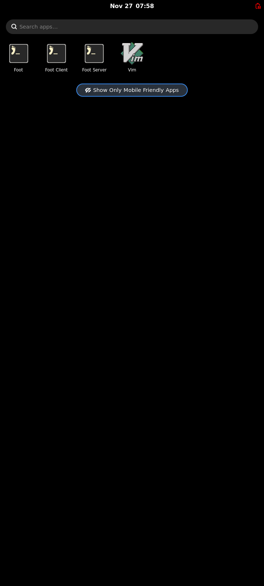
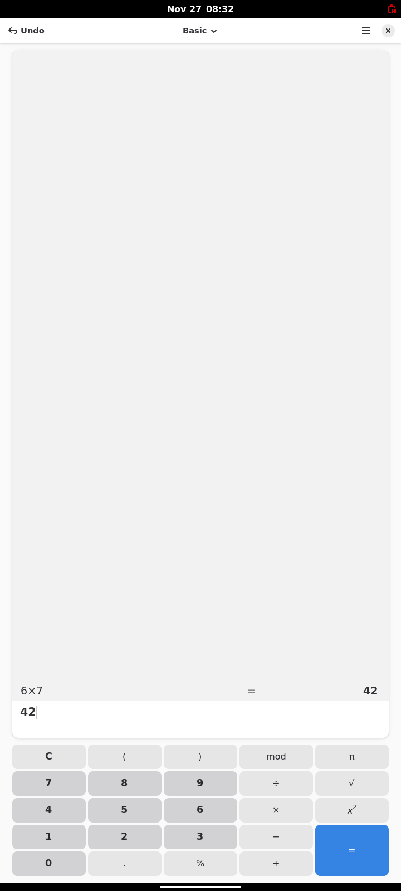

<h1 align="center">LodOS</h1>

<p align="center">
  Android için root gerektirmeyen, tek APK ile çalışan tam Linux masaüstü.<br>
  Debian 13 &middot; Wayland &middot; Phosh dokunmatik arayüz &middot; Mali GPU için Vulkan köprüsü &middot; Box64 / Wine
</p>

<p align="center">
  
  
  
  
  
  
  
</p>

> **Uyarı:** LodOS henüz alpha sürümü değildir. Kurulabilir bir APK yayımlanmadı; depo, geliştirme sürecini açık yürütmek için paylaşılıyor.

---

## Ne yapar

LodOS, telefonunuza veya tabletinize ek bir uygulama (Termux, Termux:X11, VNC vb.) kurmadan ve root gerektirmeden gerçek bir Debian sistemi getirmeyi hedefler.

| | Özellik | Durum |
|---|---|---|
|  | Debian 13 (proot ile, root gerekmez) | Çalışıyor |
|  | Kendi Wayland sunucumuz `lodos-wl` (Rust, Smithay) | Çalışıyor |
|  | Phosh dokunmatik masaüstü | PC'de ve telefonda açılıyor |
|  | Mali GPU için Vulkan köprüsü, üstünde Zink (OpenGL) | PC'de çalışıyor, telefonda test ediliyor |
|  | Box64 / FEX ile x86_64 Linux uygulamaları | Deneme aşamasında |
|  | Wine ile Windows uygulamaları ve oyun modu | Planlandı |
|  | Ayrı "Linux Terminali" ikonu (grafik olmadan kabuk) | Planlandı |
|  | Düşük donanımlı cihazlar için hafif mod | Çekirdek hazır |

## Ekran görüntüleri

<p align="center">
  
  &nbsp;
  
  &nbsp;
  
</p>
<p align="center"><sub>Soldan sağa: POCO X7 Pro üzerinde Phosh, uygulama ızgarası, ızgaradan açılan bir uygulama</sub></p>

## Mimari

```
Android uygulaması (Kotlin)
 ├─ DisplayActivity ── lodos-wl (Rust Wayland sunucusu) ── ekran / dokunmatik
 ├─ GuestSessionService ── proot ── Debian 13
 │                                    ├─ lodos-init (PID 1) ── dbus, elogind
 │                                    ├─ phoc (wlroots) ── phosh, uygulamalar
 │                                    └─ libvulkan_lodos.so (Vulkan ICD)
 └─ vk-bridge sunucusu ── Android Vulkan sürücüsü (Mali)
```

| Klasör | İçerik |
|---|---|
| `android/` | APK: kurulum sihirbazı, oturum servisi, ekran, log toplayıcı, hafif mod |
| `native/lodos-wl` | Wayland sunucusu (Smithay) |
| `native/vk-bridge` | Vulkan API köprüsü (misafir ICD + Android tarafı sunucu) |
| `native/lodos-init` | Misafir içinde PID 1 olarak çalışan küçük init |
| `native/lodos-rootfs`, `lodos-audio`, `elogind-shim`, `unix2abstract` | Rootfs kurulumu, ses, oturum ve soket yardımcıları |
| `scripts/` | Derleme, PC ve telefon test betikleri |
| `docs/research/` | Ölçümler ve teknik notlar |
| `patches/` | Kullandığımız açık kaynak projelere yaptığımız değişiklikler |
| `orch/` | Görev kuyruğu ve otomatik geliştirme döngüsü |

## Gereksinimler

- Linux bilgisayar (geliştirme için)
- Android SDK + NDK r30, CMake, JDK 17
- Rust (stable) ve `cargo-ndk`
- Test için: USB hata ayıklaması açık arm64 Android cihaz (Android 10+)

## Derleme

Ortamı yükleyin:

```bash
source orch/env.sh
```

Yerel ayar dosyası oluşturun. Bu dosya git'e eklenmez:

```bash
mkdir -p orch/local && echo 'export ANDROID_SERIAL=<cihaz-seri-no>' > orch/local/env
```

proot ve Rust bileşenlerini Android için derleyin:

```bash
scripts/build-proot.sh
```

```bash
scripts/build-rs.sh native/lodos-wl --features headless
```

Yerel kütüphaneleri APK'ya yerleştirin ve APK'yı derleyin:

```bash
scripts/stage-jnilibs.sh
```

```bash
cd android && ./gradlew assembleDebug
```

## Telefon olmadan PC'de deneme

PC'de root gerektirmeyen bir Debian misafiri kurun:

```bash
scripts/pc-guest.sh setup
```

Phosh'u PC'de, `lodos-wl` üzerinde başlatın. Ekran görüntüsü `docs/screens/` altına düşer:

```bash
scripts/pc-desktop.sh phosh
```

## Telefonda deneme (adb)

Debian rootfs'i telefona aktarın:

```bash
scripts/phone-rootfs.sh
```

Telefondaki Debian içinde komut çalıştırın:

```bash
scripts/phone-run.sh 'cat /etc/debian_version'
```

Phosh'u telefonda başlatın:

```bash
scripts/phone-desktop.sh
```

## Yol haritası

1. Telefonda ilk kullanılabilir sürüm: kurulum, Phosh, dokunmatik, ses, terminal
2. GPU hızlandırma (Zink), Box64 / Wine, uygulama başlatıcı
3. Oyun modu ve `lodos-fg`: FSR 1/2/3 ölçekleme ve kare üretimi katmanı
4. Adreno tabletler (Turnip), daha geniş cihaz desteği, F-Droid / GitHub sürümleri

## Katkı

Hata bildirimi ve önerilerinizi Issues bölümüne yazabilirsiniz. Kullandığımız açık kaynak projelerde bulduğumuz düzeltmeler `patches/` altında belgelenir ve uygun olanlar ilgili projeye geri gönderilir (`UPSTREAM.md`).

## Lisans

LodOS, [GPL-3.0-or-later](LICENSE) lisansıyla dağıtılır. Kullanılan üçüncü taraf bileşenler ve lisansları [THIRD_PARTY.md](THIRD_PARTY.md) dosyasında listelenmiştir.
